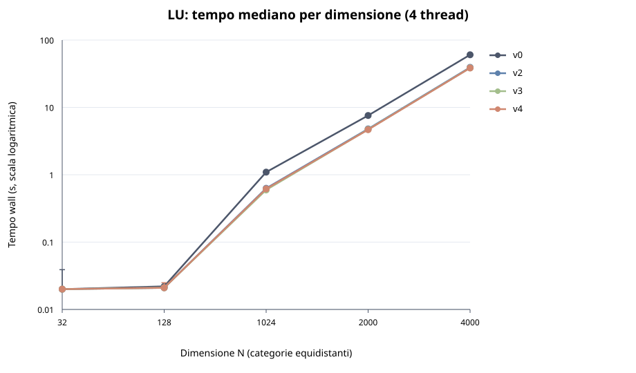
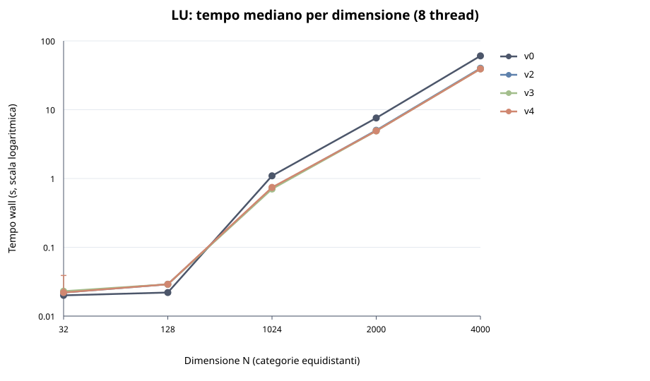
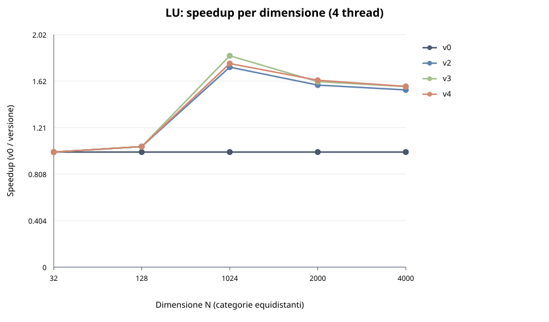
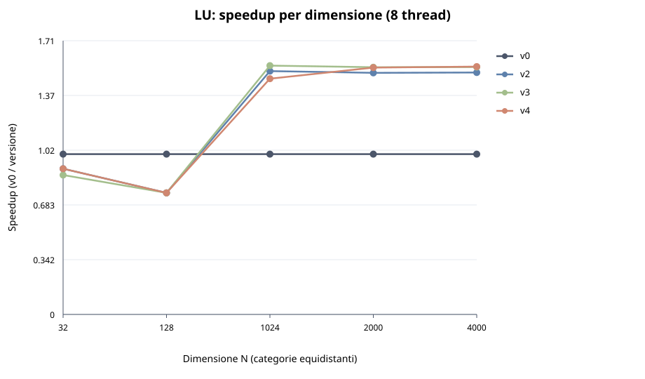

# Valutazione delle ottimizzazioni della fattorizzazione LU

> **Relazione da completare:** il riepilogo seguente usa i dati presenti in
> `lu_results.csv`. Le aspettative nelle sezioni successive non costituiscono
> risultati misurati. Ambiente effettivo e correttezza numerica sono da verificare.

## Riepilogo dei dati disponibili

Il CSV importato contiene 232 righe di misure: 200 `perf` (tutte le
combinazioni previste con cinque ripetizioni) e 32 Cachegrind (una
per combinazione fino a N=2000). Mancano le otto combinazioni Cachegrind
per N=4000. Tutte le righe presenti riportano `exit_status=0` e il numero
atteso di colonne; tutti i contatori previsti sono presenti. Lo stato di
uscita non dimostra la correttezza numerica né che gli eventi hardware
siano interpretati correttamente.

Le seguenti sono mediane di `wall_seconds` in secondi, incluso l'overhead
di `perf` e dell'intero processo:

| N | Thread richiesti | v0 | v2 | v3 | v4 |
|---:|---:|---:|---:|---:|---:|
| 32 | 4 | 0.020 | 0.020 | 0.020 | 0.020 |
| 32 | 8 | 0.020 | 0.022 | 0.023 | 0.022 |
| 128 | 4 | 0.022 | 0.021 | 0.021 | 0.021 |
| 128 | 8 | 0.022 | 0.029 | 0.029 | 0.029 |
| 1024 | 4 | 1.093 | 0.629 | 0.595 | 0.618 |
| 1024 | 8 | 1.093 | 0.720 | 0.704 | 0.743 |
| 2000 | 4 | 7.587 | 4.797 | 4.707 | 4.672 |
| 2000 | 8 | 7.587 | 5.033 | 4.920 | 4.926 |
| 4000 | 4 | 60.509 | 39.301 | 38.566 | 38.536 |
| 4000 | 8 | 60.585 | 40.140 | 39.250 | 39.188 |

Per N=1024, 2000 e 4000, le mediane delle versioni parallele con
4 thread richiesti sono inferiori a quelle con 8 thread richiesti.
La causa non è identificabile dal CSV: verificare core disponibili,
dimensione effettiva del team, affinità e condizioni della macchina.
Per N=4000 e 4 thread, v3 e v4 hanno mediane vicine (38.566 e
38.536 s) e intervalli min–max sovrapposti (38.505–39.537 e
38.499–39.676 s): non si può concludere che una sia migliore sulla
base di questa differenza. Per N=32 e 128 il tempo di processo e la
risoluzione al millisecondo limitano particolarmente l'interpretazione.

Grafici prodotti dai dati presenti:









Questi dati sono **esplorativi**: la matrice iniziale è singolare e la
correttezza della fattorizzazione non è verificata.

## 1. Obiettivo

Confrontare il tempo di esecuzione e alcuni contatori delle versioni disponibili
del kernel LU, al variare della dimensione della matrice e del numero di
thread. Il confronto riguarda le modifiche complessive tra versioni consecutive:

| Versione | Implementazione | Aspettativa da verificare |
|---|---|---|
| v0 | [lu.c](./lu.c): seriale | Riferimento per i tempi e gli speedup. |
| v2 | [lu_v2.c](./lu_v2.c): un team OpenMP persistente | Possibile beneficio su matrici sufficientemente grandi; l'overhead può prevalere su quelle piccole. |
| v3 | [lu_v3.c](./lu_v3.c): reciproco del pivot, hoisting, `restrict`, SIMD e scheduling statico | Possibile miglioramento rispetto a v2, dipendente da compilatore, CPU e dimensione. L'effetto delle singole modifiche non è isolato. |
| v4 | [lu_v4.c](./lu_v4.c): come v3, con `schedule(static,1)` sulle righe | Può cambiare località e distribuzione del lavoro rispetto a v3; un miglioramento non è garantito. |

La v1 è descritta in [Versioni_ottimizzazione.md](./Versioni_ottimizzazione.md),
ma non ha una sorgente separata e **non è misurata**: non è quindi possibile
quantificare il passaggio v1 → v2 con questo benchmark.

## 2. Ambiente sperimentale

Completare con i dati effettivi della macchina e dell'esecuzione:

| Voce | Valore |
|---|---|
| Macchina e modello CPU | **Da compilare** |
| Core fisici, CPU logiche e CPU effettivamente disponibili | **Da compilare** |
| Sistema operativo e kernel | **Da verificare:** Ubuntu 18.04.6, Linux 4.9.337-tegra |
| Versione compilatore e runtime OpenMP | **Da compilare** |
| Versioni `perf` e Valgrind | **Da compilare** |
| Commit o identificativo delle sorgenti usate | **Da compilare** |
| Flag effettivi e variabili `CC`, `CFLAGS`, `OMPFLAGS` | **Da compilare** |
| Variabili OpenMP e affinità effettive | **Da compilare** |
| Data, frequenza/gestione energetica e altri carichi | **Da compilare** |
| Nome del CSV e stato del test: completo o interrotto | **Da compilare** |

Il comando annotato nello script per Nano1 è il seguente; verificare che
corrisponda effettivamente a quello usato:

```bash
OMP_DYNAMIC=FALSE OMP_PROC_BIND=TRUE OMP_PLACES=cores \
  ./perf_valgrind.sh
```

Non assumere che 4 e 8 thread equivalgano a 4 e 8 core fisici: verificare core
disponibili, numero di thread effettivo, affinità e possibile oversubscription.
Lo script imposta `OMP_NUM_THREADS`, ma non registra la dimensione effettiva
del team né le CPU su cui viene eseguito.

## 3. Dataset e configurazioni

Le dimensioni sono definite in [lu.h](./lu.h).

| Dataset | Dimensione `N` | `perf`: completato / previsto | Cachegrind: completato / previsto |
|---|---:|---|---|
| MINI | 32 | 40 / 40 | 8 / 8 |
| SMALL | 128 | 40 / 40 | 8 / 8 |
| STANDARD | 1024 | 40 / 40 | 8 / 8 |
| LARGE | 2000 | 40 / 40 | 8 / 8 |
| EXTRALARGE | 4000 | 40 / 40 | 0 / 8 |

Con i parametri predefiniti sono previste, per ciascun dataset, quattro
versioni × due valori di `OMP_NUM_THREADS` (4 e 8), con cinque ripetizioni
`perf` e una Cachegrind per combinazione: **200 righe `perf` e 40 righe
Cachegrind** in totale, oltre all'intestazione CSV. Numeri diversi sono
attesi se si sono cambiati i parametri o interrotto il test.

Anche v0 è eseguita con entrambe le impostazioni di `OMP_NUM_THREADS`, ma
il suo kernel è seriale. Le due serie non rappresentano esecuzioni parallele
di v0. Confronti relativi a v0 usano la mediana misurata con lo stesso valore
di `OMP_NUM_THREADS` della versione parallela.

## 4. Correttezza: verifica indispensabile

L'input corrente è `A[i][j] = (i+1)(j+1)/N`: per `N > 1` è una matrice
di rango uno, quindi singolare. La LU senza pivoting incontra pivot nulli o
numericamente inaffidabili e può produrre `NaN` o infiniti.

Una verifica locale sul dataset MINI, **compilando le quattro versioni senza
OpenMP e abilitando la stampa della matrice**, ha rilevato valori non finiti
in tutte e quattro. Non è una verifica delle esecuzioni parallele su Nano1.
Un codice di uscita pari a zero non garantisce correttezza numerica.

Prima di usare i risultati come prova delle prestazioni di una fattorizzazione
valida, servono un input uguale per tutte le versioni, non singolare e adatto
alla LU senza pivoting, un controllo dei valori finiti e un confronto con
un riferimento e/o del residuo di ricostruzione. Ripetere poi le misure:
i risultati sull'input modificato non sono direttamente intercambiabili con
quelli già raccolti.

**Input, metodo, tolleranza e risultati del controllo:** **Da compilare.**

## 5. Metodologia e qualità dei dati

Il benchmark [perf_valgrind.sh](./perf_valgrind.sh) compila le versioni con
gli stessi flag e salva una riga per combinazione e ripetizione. I default
sono `gcc`, `-O2 -g -fopenmp` e `-lm`, salvo override nell'ambiente. Usa
prima `perf`, poi Cachegrind. Il CSV viene sovrascritto a ogni nuovo avvio
con lo stesso nome: conservare una copia dei risultati precedenti.

Per ogni gruppo `(N, versione, thread)`:

1. Contare le ripetizioni attese, riuscite e disponibili; verificare
   `exit_status` e gli eventuali avvisi. Non trattare celle vuote come zero.
2. Per il tempo `perf`, riportare la **mediana** e l'intervallo
   **minimo–massimo** delle ripetizioni riuscite; indicare quante sono.
3. Considerare i risultati esplorativi se incompleti, variabili o vicini
   all'overhead di misura. Il tempo è arrotondato ai millisecondi: valori
   `0.000` vengono esclusi dal generatore dei grafici.
4. Verificare che gli eventi hardware siano realmente disponibili e confrontabili
   sulla macchina. Contatori mancanti o non supportati non giustificano
   conclusioni. `exit_status=0` non garantisce che ogni contatore sia presente.

Il tempo `wall_seconds` di `perf` misura l'intera invocazione di `perf` e del
programma, inclusi avvio e inizializzazione, **non il solo kernel**. I
contatori riguardano il processo e possono includere il runtime OpenMP.
Per misurare il kernel servirebbe una strumentazione dedicata e una nuova
campagna. `task_clock_ms` è tempo CPU aggregato, non tempo trascorso.

I contatori Cachegrind sono simulazioni e Valgrind altera tempi e scheduling:
non usare il suo tempo wall per calcolare speedup nativi. Con una sola
ripetizione Cachegrind non si può stimare la variabilità. Gli errori dettagliati
degli strumenti non sono conservati nel CSV; uno stato non nullo segnala
il fallimento, ma potrebbe essere necessario ripetere una prova per diagnosticarlo.

**Righe presenti:** 232 con `exit_status=0`, nessuna con stato diverso da zero.
Mancano otto righe Cachegrind per N=4000; nessun contatore è vuoto nelle
righe presenti. Verificare comunque supporto, semantica ed eventuale
multiplexing degli eventi hardware sulla macchina.

## 6. Grafici e confronti

**Nota sulle nuove versioni intermedie:** il CSV analizzato nel riepilogo è
stato raccolto prima dell'aggiunta di `v2_simd`, `v2_recip`, `v2_hoist`,
`v2_rows` e `v2_restrict`; i risultati sopra non le includono. Per una nuova
campagna, il benchmark ora esegue nove versioni per dataset. Con i default
sono previste 450 misure `perf` e 90 Cachegrind: i conteggi della sezione 3
continuano a riferirsi alla campagna precedente. In alternativa si possono
misurare solo le cinque varianti intermedie e aggiungerle a una copia del CSV
precedente, verificando che condizioni e compilazione siano comparabili.
La sequenza e i comandi sono documentati in
[Versioni_ottimizzazione.md](./Versioni_ottimizzazione.md). Specificare che
le misure confrontate provengono da campagne diverse e non mescolare
configurazioni diverse.

Con il CSV disponibile, generare i grafici SVG:

```bash
python3 plot_lu_results.py lu_results.csv
```

Il generatore [plot_lu_results.py](./plot_lu_results.py) crea grafici di tempi
e speedup per dimensione, tempi e speedup al variare di `N` per numero di
thread e, quando disponibili, istruzioni simulate Cachegrind per dimensione.
Per esempio, i file predefiniti includono:

- `lu_results_plots/lu_wall_time_vs_n_t4.svg` e
  `lu_results_plots/lu_wall_time_vs_n_t8.svg`;
- `lu_results_plots/lu_speedup_vs_n_t4.svg` e
  `lu_results_plots/lu_speedup_vs_n_t8.svg`;
- `lu_results_plots/lu_wall_time_n1024.svg`,
  `lu_results_plots/lu_speedup_n1024.svg` e, se presente il dato,
  `lu_results_plots/lu_cachegrind_instructions_n1024.svg`.

I grafici per `N` singolo esistono solo per le dimensioni con dati `perf`
validi; i grafici al variare di `N` richiedono più dimensioni valide.
Le dimensioni sull'asse orizzontale sono categorie equidistanti; i tempi
al variare di `N` usano scala logaritmica. I grafici possono essere parziali.

### 6.1 Tempi e dimensione

**Grafici da inserire:** tempo al variare di `N`, separatamente per 4 e 8 thread.

**Aspettativa:** il tempo cresce con la dimensione; sulle matrici piccole
l'overhead del processo e delle regioni parallele può dominare.

**Risultati e considerazioni:** **Da compilare.**

### 6.2 Parallelizzazione: v0 → v2

**Grafici da inserire:** tempi e speedup per `N` e per thread.

Per ogni `N` e `T`, lo speedup mostrato è:

```text
S(v,T,N) = mediana(tempo v0, N, OMP_NUM_THREADS=T)
           / mediana(tempo v, N, T)
```

Un valore maggiore di 1 indica un tempo di processo mediano inferiore alla
baseline. I due riferimenti v0 per 4 e 8 sono misurati separatamente e possono
differire per variabilità. Il confronto non dimostra l'effetto specifico del
team persistente rispetto a v1, che non è misurata.

**Risultati e considerazioni:** **Da compilare.**

### 6.3 Ottimizzazioni combinate: v2 → v3

**Grafici da inserire:** tempi per versioni a parità di `N` e thread; eventualmente
istruzioni, cicli e IPC (`instructions / cycles`) quando disponibili.

**Aspettativa:** v3 può beneficiare di meno divisioni e della vettorizzazione,
ma il compilatore potrebbe già ottimizzare parte di v2. La differenza complessiva
non quantifica singolarmente reciproco, `restrict`, hoisting o SIMD: servirebbero
varianti intermedie e, per la vettorizzazione, un report del compilatore.

**Risultati e considerazioni:** **Da compilare.**

### 6.4 Scheduling: v3 → v4

**Grafici da inserire:** tempi e, se disponibili, contatori cache per `N` e thread.

Calcolare anche `mediana(tempo v3) / mediana(tempo v4)` con gli stessi `N` e
thread: sopra 1 indica v4 più veloce, sotto 1 indica v3 più veloce. Confrontare
la differenza con la variabilità osservata.

**Aspettativa:** `static,1` distribuisce ciclicamente le righe anziché in
blocchi; non è detto che migliori bilanciamento o località. Contatori cache
e istruzioni possono aiutare l'interpretazione, ma non provano da soli la
causa né misurano il bilanciamento per thread. Servirebbe strumentazione
per-thread per analizzarlo.

**Risultati e considerazioni:** **Da compilare.**

### 6.5 Scalabilità da 4 a 8 thread

**Grafici da inserire:** tempi per thread a `N` fissato e speedup al variare di `N`.

Confrontare `mediana(tempo a 4 thread) / mediana(tempo a 8 thread)` per la
stessa versione e dimensione, riportando l'hardware disponibile. Più thread
non garantiscono un miglioramento, specialmente con lavoro insufficiente,
sincronizzazioni o oversubscription. Non è disponibile una misura a un thread
per le versioni parallele nei default; quindi non si può calcolare la loro
scalabilità rispetto a un thread senza test aggiuntivi.

**Risultati e considerazioni:** **Da compilare.**

### 6.6 Contatori `perf` e Cachegrind

**Grafici o tabelle da inserire:** istruzioni, cicli, cache miss e/o contatori
Cachegrind disponibili, sempre distinguendo misure hardware e simulate.

Il generatore attuale visualizza solo tempo `perf`, speedup e `vg_ir`; non
genera grafici per cicli, istruzioni hardware, IPC o cache miss. Questi valori
sono nel CSV se supportati e richiedono un'elaborazione aggiuntiva. Non
confrontare automaticamente il numero di eventi `perf` con quello simulato
da Cachegrind né assumere che un numero minore di miss implichi minor tempo.

**Disponibilità dei contatori e interpretazione:** **Da compilare.**

## 7. Conclusioni e limiti

- **Correttezza numerica e test effettuati:** **Da compilare.**
- **Dataset e condizioni in cui ogni versione è risultata più veloce:** **Da compilare.**
- **Confronto v3/v4 e variabilità:** **Da compilare.**
- **Scalabilità, disponibilità dei core e possibili limiti:** **Da compilare.**
- **Contatori non disponibili e dati mancanti:** **Da compilare.**
- **Possibili sviluppi:** misurare il solo kernel, verificare la correttezza,
  aggiungere v1 e varianti intermedie, raccogliere tempi a un thread e misure
  per-thread, e ripetere in condizioni controllate.
